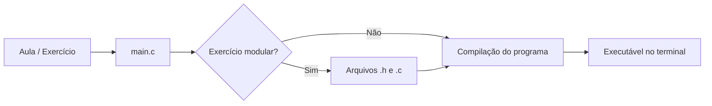

<div align="center">

# A L G O R I T M O S　//　C

### `C LANGUAGE • LOGIC • CONSOLE APPLICATIONS`

**Exercícios de algoritmos e fundamentos da programação em linguagem C.**


`FATEC` · `ADS` · `EXERCÍCIOS ACADÊMICOS`

[Visão geral](#visao-geral) · [Exercícios](#exercicios) · [Estrutura](#estrutura) · [Execução](#execucao)

</div>

---

<a id="visao-geral"></a>

## `C CORE // VISÃO GERAL`

Repositório acadêmico de **algoritmos em C**, organizado em pastas por data de aula. Contém programas de console independentes, exemplos introdutórios e exercícios de decomposição de código em arquivos `.c` e `.h`.

Este repositório não é uma aplicação única nem possui uma API: cada pasta representa um exemplo ou exercício.

## `SYSTEM // INVENTÁRIO`

| Recurso | Estado |
| :--- | :---: |
| Exercícios em C | `● PRESENTES` |
| Projetos de console | `● PRESENTES` |
| Arquivos de cabeçalho `.h` | `● PRESENTES` |
| Projetos com `CMakeLists.txt` | `● PRESENTES` |
| Interface web | `○ FORA DO ESCOPO` |

<a id="exercicios"></a>

## `ALGORITHM CORE // CONTEÚDOS IDENTIFICADOS`

| Pasta | Exemplos do código |
| :--- | :--- |
| [`11_08/`](11_08/) | Saída formatada com `printf` e representação de caracteres |
| [`18_08/`](18_08/) | `sizeof`, `#define`, `getchar` e tipos de dados |
| [`06_10/Exer.01/`](06_10/Exer.01/) | Calculadora com funções separadas de adição, subtração, divisão e multiplicação |
| [`06_10/exer02/`](06_10/exer02/) | Conversão entre Celsius e Fahrenheit |
| [`06_10/exer03/`](06_10/exer03/) | Exemplo de inversão de dados |
| [`03_11/Sistema01/`](03_11/Sistema01/) | Estruturas `Empregado` e `Cliente`, leitura e exibição de registros |

Os demais exercícios também estão organizados em pastas de aula com seus respectivos arquivos-fonte.

## `ARCHITECTURE // ORGANIZAÇÃO DOS EXERCÍCIOS`



<a id="estrutura"></a>

## `STRUCTURE // REPOSITÓRIO`

```text
Algoritimos-com-C/
├── 11_08/
├── 18_08/
├── 25_08/
├── 01_09/
├── 08_09/
├── 15_09/
├── 06_10/
│   ├── Exer.01/
│   │   ├── main.c
│   │   ├── adicao.c / adicao.h
│   │   ├── subtracao.c / subtracao.h
│   │   ├── divisao.c / divisao.h
│   │   └── multiplicacao.c / multiplicacao.h
│   └── exer02/
├── 03_11/
└── README.md
```

<a id="execucao"></a>

## `BOOT SEQUENCE // EXECUÇÃO LOCAL`

**Pré-requisitos:** compilador C (GCC ou Clang). Vários exercícios também possuem configuração **CMake**.

```bash
git clone https://github.com/gilbertocorrea-cmd/Algoritimos-com-C.git
cd Algoritimos-com-C
```

Para compilar um exercício simples no Linux:

```bash
cd 11_08/exemplo1
gcc main.c -o exemplo1
./exemplo1
```

Para a calculadora modular, compile todos os arquivos de implementação:

```bash
cd 06_10/Exer.01
gcc main.c adicao.c subtracao.c divisao.c multiplicacao.c -o calculadora
./calculadora
```

> Os comandos acima são exemplos de compilação, não uma execução automatizada de todos os exercícios. Alguns projetos podem exigir ajustes específicos ou bibliotecas adicionais.

## `LEARNING // CONCEITOS PRATICADOS`

- Entrada e saída com `scanf` e `printf`.
- Tipos, variáveis e operadores.
- Condicionais, laços e menus de console.
- Funções, parâmetros e ponteiros.
- `struct` para agrupar dados.
- Separação de implementação (`.c`) e interface (`.h`).
- Organização de builds com CMake.

---

<div align="center">

## `C // COMPILE • RUN • LEARN`

**Gilberto Corrêa**

Análise e Desenvolvimento de Sistemas — FATEC

[GitHub](https://github.com/gilbertocorrea-cmd)

`C` • `ALGORITHMS` • `CMAKE` • `CONSOLE`

</div>
